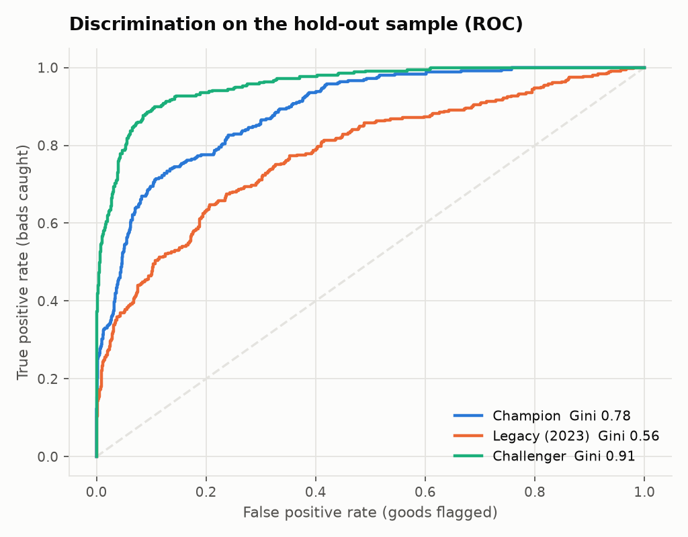
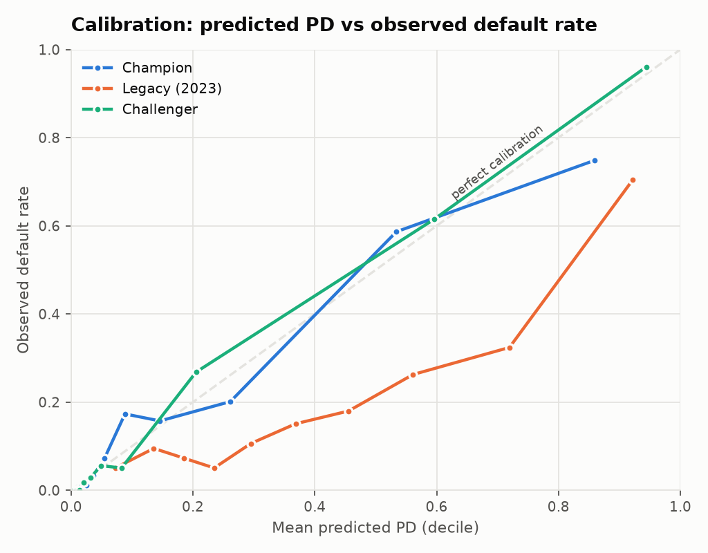
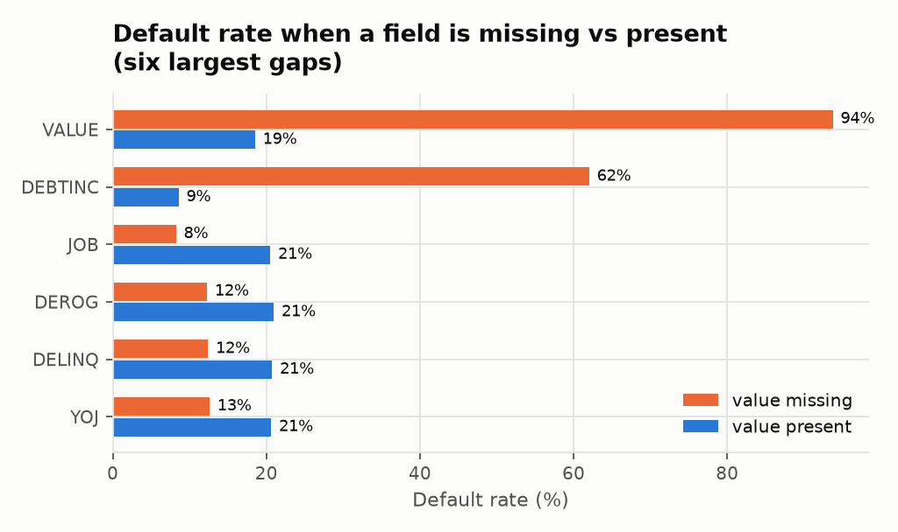

# Independent validation report: HMEQ probability-of-default model

*Generated by `python -m pdval.report` on 15 October 2026. Every figure below is recomputed on each run.*

## 1. Scope

Model under review: a probability-of-default (PD) scorecard for home-equity loans, built as a weight-of-evidence (WoE) logistic regression (**Champion**). Two comparators are assessed alongside it:

- **Legacy (2023):** a reconstruction of my earlier notebook approach (median imputation, SMOTEENN rebalancing, logistic regression).
- **Challenger:** gradient boosting on raw features, used purely as a performance benchmark.

Data: 5,960 loans, 19.9% default rate. Stratified split: 4,172 development / 1,788 hold-out (seed 42). Tests follow the usual structure of model risk validation (SR 11-7 / PRA SS1/23): data, conceptual soundness, discrimination, calibration, stability, benchmarking.

## 2. Summary of results

| model | Gini (train) | Gini (test) | Gini 95% CI | KS | Mean PD | Observed DR | Brier | HL p-value | Grades failing | Score PSI |
|---|---|---|---|---|---|---|---|---|---|---|
| Champion | 0.801 | 0.778 | 0.742 to 0.811 | 0.606 | 20.3% | 20.0% | 0.098 | <0.001 | 3 of 7 | 0.006 |
| Legacy (2023) | 0.631 | 0.559 | 0.503 to 0.614 | 0.440 | 39.5% | 20.0% | 0.174 | <0.001 | 4 of 7 | 0.017 |
| Challenger | 0.976 | 0.912 | 0.890 to 0.931 | 0.793 | 19.6% | 20.0% | 0.060 | 0.101 | 1 of 7 | 0.008 |

## 3. Findings

Severity uses a common three-level scale: **High** must be fixed before use, **Medium** needs a remediation plan, **Low** is an observation.

### F1 (High): Rebalancing destroys PD calibration in the legacy model

After SMOTEENN the training data is 49.7% bad, against 19.9% in reality, so the model learns the wrong base rate. On the hold-out sample the legacy model's average PD is **39.5%** against an observed default rate of **20.0%**. 4 of 7 PD grades fail the binomial test, and Hosmer-Lemeshow rejects calibration outright. Rebalancing can help a classifier pick a threshold, but a PD model's output is a probability that feeds provisions and capital, so it must stay on the true base rate. **Remediation:** do not rebalance PD models; if rebalancing is unavoidable, recalibrate to the observed default rate afterwards. Applied in the Champion.

### F2 (High): Missing values carry the strongest signal, and the reason is unexplained

When DEBTINC is missing (21.3% of loans) the default rate is **62.0%**, against 8.6% when it is present. For VALUE the gap is 93.8% vs 18.5% (1.9% missing). Median imputation, as used in the legacy model, erases this, which is a large part of why its Gini is only 0.56. The Champion keeps missing values as their own WoE bin, and DEBTINC's information value is 1.79, far above the 0.5 level at which a variable is normally treated as suspiciously strong. Without DEBTINC the Champion's Gini falls from 0.778 to 0.566. If DEBTINC goes missing *because of* the outcome (for example, it is only collected for applications that progress normally), this is target leakage and the model would not perform like this in production. **Remediation:** the model owner must document why DEBTINC is missing before the variable is accepted.

### F3 (Medium): Champion is accurate on average but mis-calibrated in the middle grades

Average PD matches the observed rate (20.3% vs 20.0%), but Hosmer-Lemeshow rejects decile-level calibration and 3 of 7 grades fail the binomial test. The concern is grade G3, where the observed default rate (13.2%) is above the assigned PD (7.0%): the model is *not conservative* there. Failures where the model over-predicts are conservative and lower priority. **Remediation:** recalibrate by grade (for example isotonic or a grade-level scaling) and add a margin of conservatism.

| grade | pd_range | n | defaults | mean_pd | observed_dr | binomial_p | result |
|---|---|---|---|---|---|---|---|
| G1 | 0%-2% | 326 | 0 | 1.2% | 0.0% | 0.039 | FAIL |
| G2 | 2%-5% | 436 | 12 | 3.2% | 2.8% | 0.684 | pass |
| G3 | 5%-10% | 266 | 35 | 7.0% | 13.2% | 0.000 | FAIL |
| G4 | 10%-20% | 244 | 38 | 14.3% | 15.6% | 0.582 | pass |
| G5 | 20%-35% | 141 | 30 | 26.0% | 21.3% | 0.213 | pass |
| G6 | 35%-60% | 146 | 75 | 47.5% | 51.4% | 0.363 | pass |
| G7 | 60%-100% | 229 | 167 | 81.3% | 72.9% | 0.002 | FAIL |

### F4 (Medium): The benchmark is materially stronger

The Challenger reaches a hold-out Gini of **0.912** against the Champion's 0.778. It is also better calibrated (lower Brier score). The bootstrap intervals (0.890 to 0.931 vs 0.742 to 0.811) do not overlap, so the gap is not noise. Its train/test gap (0.976 vs 0.912) shows some overfitting. A gap this size usually means interactions the scorecard cannot express. **Remediation:** investigate which interactions drive the lift (e.g. SHAP on the Challenger), and either add them to the scorecard or record why interpretability is worth the lost discrimination.

### F5 (Low): Variable review

All selected WoE coefficients are negative, which is the correct sign (higher WoE means safer). Dropped: REASON (IV 0.011 below 0.02). Weak variables kept in the model (MORTDUE, YOJ, CLNO, DEROG) add complexity for little gain and could be pruned.

| variable | IV | Bins | Strength | Coefficient |
|---|---|---|---|---|
| DEBTINC | 1.793 | 6 | suspicious | -0.968 |
| DELINQ | 0.423 | 3 | strong | -1.060 |
| VALUE | 0.377 | 6 | strong | -0.929 |
| CLAGE | 0.218 | 6 | medium | -1.118 |
| JOB | 0.144 | 7 | medium | -1.109 |
| NINQ | 0.131 | 4 | medium | -0.685 |
| LOAN | 0.104 | 5 | medium | -0.063 |
| MORTDUE | 0.064 | 6 | weak | -0.229 |
| YOJ | 0.055 | 6 | weak | -0.965 |
| CLNO | 0.036 | 6 | weak | -1.295 |
| DEROG | 0.033 | 2 | weak | -1.544 |
| REASON | 0.011 | 3 | useless | dropped |

### F6 (Low): Stability can only be checked weakly

Score PSI between development and hold-out is 0.0058, and the largest characteristic PSI is 0.0061 (YOJ), all stable, but that is expected from a random split. HMEQ has no dates, so a true out-of-time test is impossible. **Remediation:** before use, test on a later vintage and set monitoring triggers (PSI above 0.10 = review, above 0.25 = redevelop).

## 4. Overall opinion

The Champion is conceptually sound and a clear improvement on the 2023 approach, but it is **not fit for use** until F2 (the source of DEBTINC missingness) is explained, and its middle-grade calibration (F3) is fixed. The Legacy model should be retired.

## 5. Limitations of this validation

- Public teaching dataset; no business owner to answer F2, no production data, no vintages.
- Single random split; results could move with a different seed (bootstrap intervals give a sense of how far).
- The Legacy reconstruction leaves out the K-means segmentation step of the original notebook. The original also imputed missing values on the full dataset *before* splitting, which leaks hold-out information; the reconstruction fits imputation on the development sample only.
